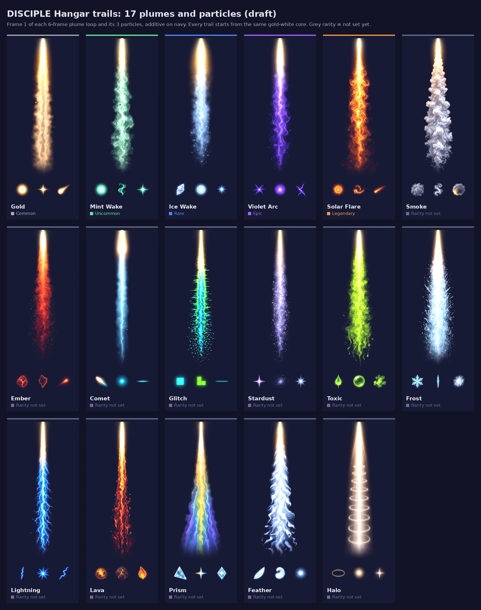

# Hangar trails

There are 17 engine trails for the Hangar collection, made to lee's Hangar brief (Part A). Each one has a looping plume and a set of 3 particles. This is art only, and nothing is wired up yet.

## Files

The game files are in `web/public/turbo/trails/`, next to the skins and crates from #421.

- `trail-<id>-plume.png` is 1536×768: 6 frames of 256×768 in one row. The plume points straight down and its nozzle sits at the top centre of every frame (x 128, y 0). Play it at 12 fps. Frame 6 flows back into frame 1.
- `trail-<id>-bits.png` is 384×128: 3 particles of 128×128, each centred in its cell. Sprinkle them along the contrail.
- Both are on pure black (#000000), so draw them with additive blending (`globalCompositeOperation = "lighter"` on canvas). Black adds nothing.
- The animated previews are `trail-<id>-plume.webp` in this folder, at half size on navy.

This is the same flipbook sprite sheet format that Unity and Unreal use for particle textures, and it matches the layout of the fx sheets in #402.

## Rules every trail follows

- The top 10% is the same white-hot core (#FFF6DC) into gold (#F2C14E), so your rocket always reads as gold, whatever trail you fly.
- Below the core, each trail turns into its own colour and style, then fades out before the bottom edge.
- There's no pink, which stays for rivals. No text or logos.

## The 17

| id | Name | Rarity | Series | Look | Particles |
|---|---|---|---|---|---|
| gold | Gold | Common | Starter | Warm gold to champagne flame | Soft gold puffs |
| mint | Mint Wake | Uncommon | 1 | Soft, rounded mint wake | Mint smoke puffs |
| ice | Ice Wake | Rare | 1 | Thin, fast icy blue | Ice shards |
| violet | Violet Arc | Epic | 1 | Violet with electric flicker | Tiny violet sparks |
| solar | Solar Flare | Legendary | 1 | Deep orange, like the sun's surface | Big falling sparks |
| smoke | Old Smoke | Common | 1 | Thick grey smoke, no colour | Grey smoke puffs |
| ember | Ember | Uncommon | 1 | Red-orange coals | Embers and ash |
| comet | Comet | Rare | 1 | Long, thin champagne tail | Twinkling star glints |
| glitch | Glitch | Epic | 1 | Cyan and violet in blocky pixel steps | Square pixels, scanline bits |
| stardust | Stardust | Legendary | 1 | Deep-space nebula with a small galaxy swirl | Tiny stars, a galaxy swirl |
| toxic | Toxic Drip | Uncommon | 2 | Acid green that drips | Green droplets |
| frost | Frost | Rare | 2 | Pale blue mist | Snowflakes |
| lightning | Storm | Epic | 2 | White-blue plume with branching bolts | Small bolts |
| lava | Lava | Epic | 2 | Molten orange rock | Lava blobs cooling to black |
| prism | Prism | Legendary | 2 | Rainbow light split, like glass | Little prisms, light flecks |
| feather | Seraph | Mythic | 2 | Soft white light with drifting feathers | White and gold feathers |
| halo | Halo | Prestige only | Prestige 2 | Gold beam with rings travelling down | Small gold rings |

The ids match the brief, and the names, rarities and series come from its table. Halo isn't a rarity tier, so its label on the contact sheet uses the "you" gold, #F2C14E.

## Motion

Each trail started from one generated master plume and one sheet of particles. The 6 frames were then built in code, so the nozzle never moves and the loop is exact.

- The flame streams downward. The texture drifts down and crossfades between two offsets, and the turbulence and brightness noise scroll down by exactly one period per loop.
- The trail's own particles drift off the sides. Each one lives for exactly one loop.
- Halo's rings travel down the beam, growing as they go. A new ring fades in at the top as the bottom one fades out.
- Storm flashes through 3 different bolt patterns, two frames each, so it never shows a mirror image.
